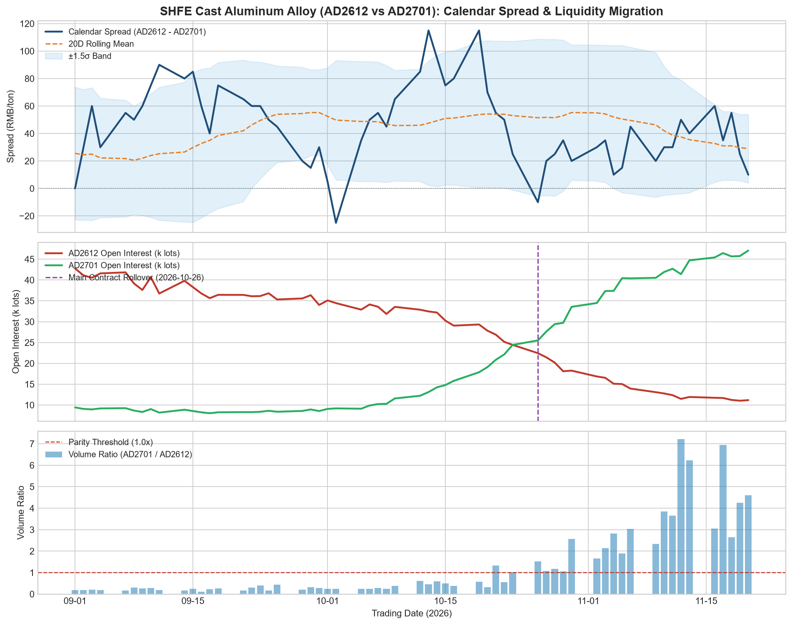
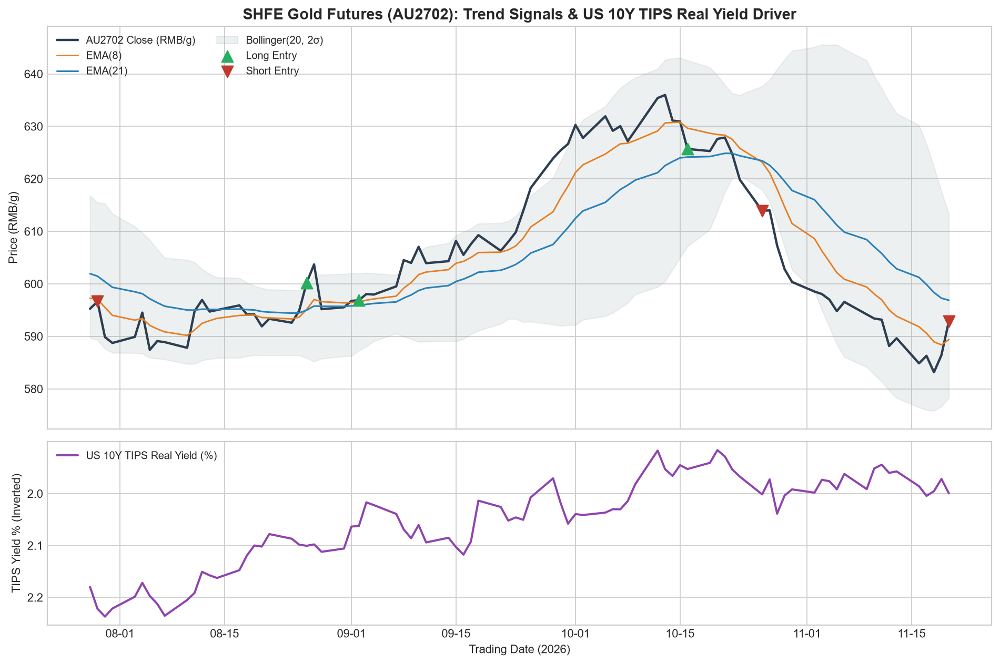
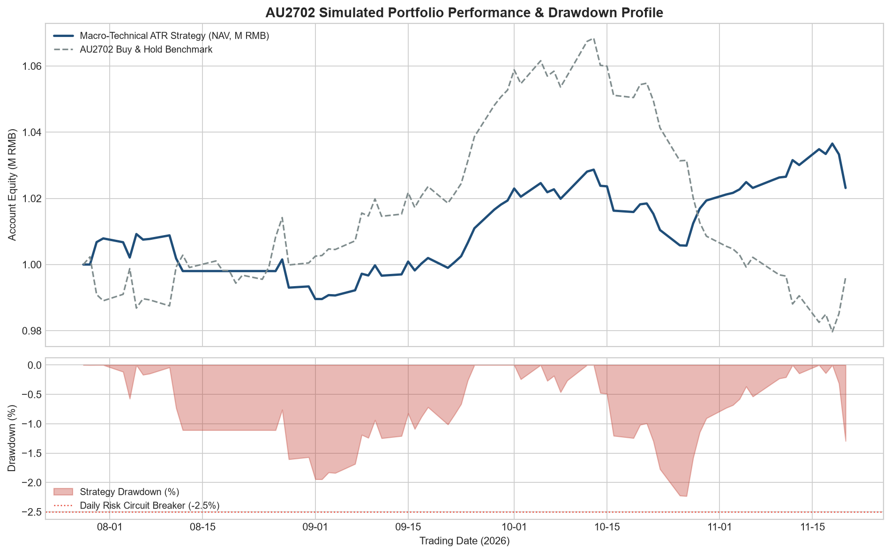

# 期货交易系统构建与贵金属/有色金属合约跟踪分析框架

> **SHFE Futures Trading & Commodity Analytics Framework**  
> 覆盖 **铸造铝合金（`AD2612` / `AD2701`）跨期价差与流动性监控** 与 **黄金期货（`AU2702`）宏观-技术面趋势策略及盘口微结构分析**。


---

## 一、项目背景与核心模块

本项目对应大宗商品期货交易系统构建与实训研究，完整实现了从 **品种筛选 → 跨期价差与移仓监控 → 宏观/技术面定价拆解 → 波动率仓位与止损风控 → 阶段性复盘报告自动输出** 的端到端量化分析工作流：

1. **有色金属跨期与流动性监控（`src/spread_liquidity_monitor.py`）**
   - 跟踪上期所铸造铝合金 `AD2612`（主力）与 `AD2701`（次主力）跨期价差、20 日滚动 Z-Score 均值回归区间与年化移仓收益。
   - 基于持仓量份额（`OI_2701 / Total_OI > 50%`）、成交量比值与 Amihud 非流动性代理指标，自动识别主力换月拐点（`2026-10-26`），并为策略标的切换至高流动性黄金合约提供数据依据。
2. **贵金属宏观-技术面策略与风控引擎（`src/gold_strategy_engine.py`）**
   - 引入 **美债 10 年期实际利率（US 10Y TIPS）** 与 **美元指数（DXY）** 10 日动量作为宏观状态过滤器，叠加 `EMA(8)/EMA(21)` 趋势、`Bollinger(20, 2σ)` 通道与 `RSI(14)` 动量信号。
   - 内置 **ATR(14) 波动率目标仓位管理**（单笔交易风险敞口严格限制在账户净值的 `1.2%` 以内，单品种保证金占用上限 `35%`）与 **`2.0 × ATR` 移动止损** 规则。
3. **盘口微结构监控与自动复盘报告（`src/risk_and_report.py`）**
   - 计算 `AU2702` 日内 1 分钟盘口买卖价差（bps）、五档盘口失衡度（Order Book Imbalance, OBI）与会话 VWAP。
   - 自动汇总策略指标与成交台账，生成结构化 Markdown 阶段复盘报告：[reports/phase_review_report.md](reports/phase_review_report.md)。

---

## 二、核心实证结果一览

### 1. 铸造铝合金 `AD2612 / AD2701` 跨期价差与流动性迁移

- **10–11 月跨期价差均值**：`42.57 RMB/吨`（区间 `-25.0` 至 `115.0 RMB/吨`），年化移仓收益约 `2.53%`
- **主力移仓拐点**：`2026-10-26`（期末 `AD2701` 持仓占比 `80.8%`）



### 2. 黄金期货 `AU2702` 宏观-技术面信号与组合绩效

| 指标 | 实测结果 | 指标 | 实测结果 |
| :--- | :---: | :--- | :---: |
| 累计收益率（84 个交易日） | **+2.31%** | 年化收益率 | **+7.10%** |
| 年化波动率 | **5.29%** | 夏普比率（Rf=2%） | **0.97** |
| 最大回撤 | **-2.23%** | 卡玛比率（Calmar） | **3.18** |
| 盈亏比（Profit Factor） | **2.09** | 交易胜率（趋势策略） | **33.3%（6 笔）** |
| AU2702 vs TIPS 日变动相关性 | **-0.354** | 日内盘口平均价差 | **0.92 bps** |





---

## 三、目录结构

```text
futures-trading-analytics/
├── run_all.py                          # 一键运行全流程（数据生成/监控/回测/图表/报告）
├── requirements.txt
├── src/
│   ├── data_pipeline.py                # 合约行情与盘口数据管线（支持 --live 对接 AkShare）
│   ├── spread_liquidity_monitor.py     # AD2612/AD2701 跨期价差与流动性迁移分析
│   ├── gold_strategy_engine.py         # AU2702 宏观+技术趋势策略与 ATR 仓位风控回测
│   └── risk_and_report.py              # AU2702 盘口微结构统计与 Markdown 复盘报告生成
├── data/                               # 校准后的日线 OHLCV/OI、宏观因子与 1 分钟盘口数据
├── reports/                            # 自动输出的阶段性复盘报告与指标 JSON
└── assets/                             # 自动生成的高清分析图表
```

---

## 四、快速运行

```bash
pip install -r requirements.txt
python run_all.py

# 如需尝试在线拉取上期所主连实时行情（需额外安装 akshare）：
# python -m src.data_pipeline --live
```

> **说明**：仓库默认提供符合 SHFE 合约乘数（AD 10 吨/手，AU 1000 克/手）与最小变动价位校准的离线可复现数据集，确保任意环境下均可一键复现全部回测指标与图表；同时保留 AkShare 在线拉取接口以便扩展实盘跟踪。
